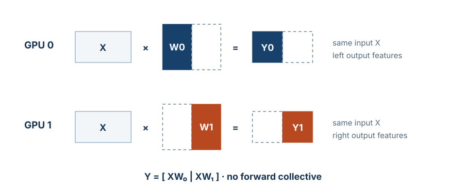
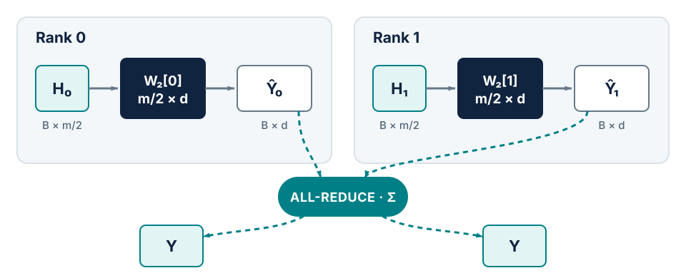
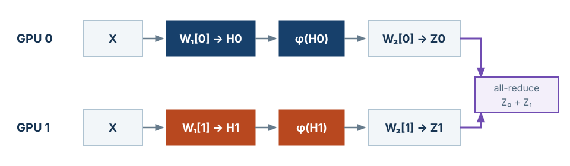

# Module 7 Lab — Implement tensor parallelism; read a sharded checkpoint

This lab accompanies [Module 7: Tensor parallelism](../modules/07-tensor-parallelism.md)
and finishes the checkpoint part of [Module 6](../modules/06-fsdp.md#checkpointing-is-a-distributed-data-problem).
Session 21 has two parts:

- **Part A (25 min):** save a model trained by two FSDP2 ranks in two formats,
  then reload both into one process and prove they hold the same model.
- **Part B (50 min):** implement Megatron-style column- and row-parallel layers,
  including the collectives autograd needs in backward, and verify them on two CPU ranks.

!!! tip "Files used in this lab"
    - **Starter:** [`starter/07_tensor_parallel.py`](https://github.com/brain-bzh/llm-course-companion/blob/main/starter/07_tensor_parallel.py)
    - **Your implementation:** [`nanolm/tensor_parallel.py`](https://github.com/brain-bzh/llm-course-companion/blob/main/nanolm/tensor_parallel.py)
    - **Experiments:** [`scripts/07_tensor_parallel.py`](https://github.com/brain-bzh/llm-course-companion/blob/main/scripts/07_tensor_parallel.py) · [`scripts/06_fsdp2.py`](https://github.com/brain-bzh/llm-course-companion/blob/main/scripts/06_fsdp2.py) · [`scripts/06_checkpoint_formats.py`](https://github.com/brain-bzh/llm-course-companion/blob/main/scripts/06_checkpoint_formats.py)
    - **Tests:** [`tests/test_module_07_tp.py`](https://github.com/brain-bzh/llm-course-companion/blob/main/tests/test_module_07_tp.py)

## Before class (20 minutes)

Read the derivation below and [Forward and backward are conjugate](../modules/07-tensor-parallelism.md#forward-and-backward-are-conjugate).
Then answer on paper, for a GPT-2 MLP with $d=768$ on two TP ranks and an input
of shape $B\times T\times d$:

1. the shape of each rank's `c_fc` weight, its hidden activation, and its `c_proj` weight;
2. which tensors are replicated, which are sharded, and where the single
   forward all-reduce happens;
3. why the **backward** pass needs an all-reduce at the **input** of the column layer.

Prepare the environment:

```bash
git switch -c session-21-tp
cp starter/07_tensor_parallel.py nanolm/tensor_parallel.py
uv run pytest tests/test_module_07_tp.py -q   # 2 tests fail with NotImplementedError
```

## Session 21 protocol — 75 minutes

| Time | Activity | Evidence |
| --- | --- | --- |
| 0–10 min | Part A: save and reload full vs sharded checkpoints; questions 1–2 | `PASS:` from the reload |
| 10–25 min | Part B, step 1: the two autograd functions | Single-rank test passes |
| 25–45 min | Part B, step 2: column and row layers; two-rank run | `PASS:` with outputs, input gradient and weight shards |
| 45–60 min | Part B, step 3: break the backward contract on purpose | Explanation of which gradient breaks and why the forward still passes |
| 60–75 min | Shape ledger and degree discussion | Completed ledger for a GPT-2 block at TP=2 |
| After class | Part A, questions 3–4 | A format choice and a validation for four scenarios |

Part A closes Module 6 and needs only two commands. Most of the session goes to
tensor parallelism, the hardest idea in the course so far.

## Part A — Checkpoint formats (10 minutes)

A training job usually saves one of two things:

- a **full** checkpoint: rank 0 gathers every tensor into one file. It is simple
  to load anywhere, but every byte travels to one rank, and the whole model must
  fit in that rank's memory;
- a **sharded (distributed) checkpoint**: every rank writes its own slice in
  parallel, plus a metadata file that records which slice of each tensor lives
  where. It is fast to write and needs no single rank to hold everything, but
  it needs a loader that understands the metadata.

Produce both from a two-rank FSDP2 run, then reload both in a single process:

```bash
uv run torchrun --standalone --local-addr=127.0.0.1 --nproc_per_node=2 scripts/06_fsdp2.py --save runs/fsdp2-ckpt
uv run python scripts/06_checkpoint_formats.py runs/fsdp2-ckpt
```

```text
files on disk:
  runs/fsdp2-ckpt/full.pt                         123,097 B
  runs/fsdp2-ckpt/sharded/.metadata                38,799 B
  runs/fsdp2-ckpt/sharded/__0_0.distcp            259,338 B
  runs/fsdp2-ckpt/sharded/__1_0.distcp            305,137 B

sharded metadata: 20 model tensors, 69 optimizer entries
  model.transformer.h.0.mlp.c_fc.weight: global (128, 32), slice at (0, 0) size (64, 32), slice at (64, 0) size (64, 32)

max |full - resharded| over all tensors = 0.0e+00
identical logits from both reloads: True
PASS: a 2-rank sharded checkpoint reloads into 1 process and equals the gathered full checkpoint.
```

Answer questions 1 and 2 in class, and 3 and 4 after class:

1. Why are the sharded files together much larger than `full.pt`? (Look at what
   was saved in each format.)
2. The checkpoint was written by 2 ranks and read by 1. Which line of the
   metadata made that **resharding** possible?
3. The script's last line lists what it does not cover. Which of those items
   would break *exact* resumption of training (compare with the
   [Module 2 recovery test](02-training-loop.md#recovery-experiment))?
4. Choose a format, and say how you would validate it, for each scenario in
   [Module 6, Part C](../modules/06-fsdp.md#part-c-checkpoint-choice): fast restart of a 256-GPU job;
   publishing weights for single-GPU inference; resuming on a different world size;
   archiving optimizer state for exact recovery.

## Part B — Tensor-parallel layers (65 minutes)

### The mathematics (read before class)


Consider a standard linear layer mapping an input vector $X \in \mathbb{R}^{B \times d_{\text{in}}}$ to an output $Y \in \mathbb{R}^{B \times d_{\text{out}}}$ using weight matrix $W \in \mathbb{R}^{d_{\text{out}} \times d_{\text{in}}}$:

$$Y = X W^T$$

In Tensor Parallelism (TP), we divide $W$ across $P$ ranks (our tensor-parallel world size). There are two complementary ways to partition the matrix.

#### Column parallelism (Partitioning Output Features)

We split $W$ along its output dimension (the columns of $W^T$):

$$W = \begin{bmatrix} W_0 \\ W_1 \\ \vdots \\ W_{P-1} \end{bmatrix}, \quad \text{where each } W_p \in \mathbb{R}^{\frac{d_{\text{out}}}{P} \times d_{\text{in}}}$$

Every rank receives the **full, replicated input** $X$ and multiplies it by its local weight shard $W_p$:

$$Y_p = X W_p^T \in \mathbb{R}^{B \times \frac{d_{\text{out}}}{P}}$$

<figure markdown="span">
  { loading=lazy }
  <figcaption>Each rank receives the identical input X and computes its own slice of the output features.</figcaption>
</figure>

- **Input:** Replicated across all ranks ($B \times d_{\text{in}}$).
- **Computation:** Completely independent (zero communication).
- **Output:** Sharded across ranks along the feature dimension ($B \times \frac{d_{\text{out}}}{P}$).

#### Row parallelism (Partitioning Input Features)

We split $W$ along its input dimension (the rows of $W^T$):

$$W = \begin{bmatrix} W_0 & W_1 & \cdots & W_{P-1} \end{bmatrix}, \quad \text{where each } W_p \in \mathbb{R}^{d_{\text{out}} \times \frac{d_{\text{in}}}{P}}$$

Each rank $p$ receives a **sharded input** $X_p \in \mathbb{R}^{B \times \frac{d_{\text{in}}}{P}}$ matching its slice of the weights:

$$\hat{Y}_p = X_p W_p^T \in \mathbb{R}^{B \times d_{\text{out}}}$$

<figure markdown="span">
  { loading=lazy }
  <figcaption>Each rank computes a partial result; an all-reduce sums them to reproduce the full output.</figcaption>
</figure>

Notice that each $\hat{Y}_p$ has the full output dimension $d_{\text{out}}$, but represents only a **partial sum**. To recover the complete output $Y$, all ranks must sum their contributions:

$$Y = \sum_{p=0}^{P-1} \hat{Y}_p = \sum_{p=0}^{P-1} X_p W_p^T$$

This summation is performed using an **All-Reduce** collective with the `SUM` operator.

---

#### The Megatron column → row MLP

Why not simply use Column Parallelism everywhere?

If a layer's output is sharded along the feature dimension, the next layer cannot consume it unless all ranks synchronize using an `all_gather` collective.

The breakthrough insight of Megatron-LM (Shoeybi et al., 2019) is that **Column Parallelism and Row Parallelism are exact duals**:

<figure markdown="span">
  { loading=lazy }
  <figcaption>The Column-to-Row chain: hidden representations remain sharded through the activation function, requiring only a single all-reduce at the end.</figcaption>
</figure>

1. **First projection ($W_1$, Column-Parallel):**
   $$H_p = X W_{1, p}^T \in \mathbb{R}^{B \times \frac{4d}{P}}$$
2. **Pointwise activation ($\text{GELU}$):**
   Because $\text{GELU}$ is an elementwise non-linearity, rank $p$ applies it directly to its local hidden shard:
   $$Z_p = \text{GELU}(H_p) \in \mathbb{R}^{B \times \frac{4d}{P}}$$
   **Zero communication is required.**
3. **Second projection ($W_2$, Row-Parallel):**
   $W_2$ partitions its input features along the exact same dimension that $Z_p$ is sharded along:
   $$\hat{Y}_p = Z_p W_{2, p}^T \in \mathbb{R}^{B \times d}$$
4. **Final All-Reduce:**
   A single collective sums the partial results across all ranks:
   $$Y = \text{all\_reduce}(\hat{Y}_p, \text{op}=\text{SUM}) \in \mathbb{R}^{B \times d}$$

The entire 2-layer MLP executes with **only one communication collective** in the forward pass.

### Step 1 — The communication contract (15 minutes)

Each rank evaluates the **same** replicated loss, so autograd needs exactly one
collective at each boundary. The forward and backward collectives are each
other's conjugate:

| Boundary | Forward | Backward |
| --- | --- | --- |
| Replicated $X$ → column-parallel layer (`_CopyToTP`) | identity | **sum** $\partial L/\partial X$ over ranks |
| Row-parallel partial sums → replicated $Y$ (`_ReduceFromTP`) | **sum** over ranks | identity |

Implement `_CopyToTP.backward` and `_ReduceFromTP.forward`. `dist.all_reduce`
works **in place**, so clone first. Skip the collective when `world_size == 1`.
Why does `_ReduceFromTP.backward` *not* all-reduce? Every rank already holds
the same $\partial L/\partial Y$. Summing it again would multiply it by the TP degree.

### Step 2 — The layers (20 minutes)

- `ColumnParallelLinear.forward`: `F.linear(_CopyToTP.apply(x, world), weight, bias)`.
  Each rank owns `out_features / world` output rows of the weight and bias.
- `RowParallelLinear.forward`: partial product with **no bias**, then
  `_ReduceFromTP.apply`, then add the bias **once**. If every rank added it
  before the sum, the bias would be counted `world` times.

```bash
uv run pytest tests/test_module_07_tp.py -k single_rank -q
uv run torchrun --standalone --local-addr=127.0.0.1 --nproc_per_node=2 scripts/07_tensor_parallel.py
```

```text
PASS: TP outputs, input gradients and both parameter shards match the reference.
```

`verify_sharded_mlp` (in your file, provided) copies **slices** of one dense MLP
into the two ranks. Rank $r$ gets rows $[r\frac{4d}{P}, (r+1)\frac{4d}{P})$ of
`fc1` and the matching **columns** of `fc2`. It then compares the output, the
input gradient and both weight-gradient shards with the dense model.

### Step 3 — Break the backward contract (15 minutes)

In `_CopyToTP.backward`, comment out the all-reduce and rerun the two-rank
script. Before reading the error, predict which comparison fails first:

- the forward output?
- `fc1`'s and `fc2`'s weight gradients?
- the input gradient $\partial L/\partial X$?

Only the input gradient is wrong: each rank returns the contribution of its own
columns. The forward pass and both local weight gradients are still correct.
In a full model, that wrong $\partial L/\partial X$ flows into the attention
block, the LayerNorm and the embeddings, so **every earlier layer** trains on
a corrupted gradient while the loss can still go down. Restore the all-reduce
and write the lesson in your log.

### Step 4 — Shape ledger (15 minutes)

Complete the ledger for one GPT-2-small block ($d=768$, 12 heads) at TP=2,
$B\times T$ tokens, as in [Module 7, Part A](../modules/07-tensor-parallelism.md#part-a-layout-ledger):

| Tensor | Shape per rank | Replicated or sharded | Collective (forward / backward) |
| --- | --- | --- | --- |
| block input $X$ | | | |
| Q, K, V weights | | | |
| attention heads per rank | | | |
| attention output projection | | | |
| `c_fc` weight / hidden activation | | | |
| `c_proj` weight / output | | | |

How many all-reduces does one block need in forward, and how many in backward?
What constraint does the head count put on the TP degree?

## Definition of done

- Part A: `06_checkpoint_formats.py` prints `PASS:`, and you have a format and a
  validation procedure for each of the four scenarios;
- `tests/test_module_07_tp.py` passes with your `nanolm/tensor_parallel.py`, and
  the two-rank script prints `PASS:`;
- you can explain why removing the input-gradient all-reduce leaves the forward
  output and the local weight gradients correct but breaks training;
- a completed shape ledger with the per-block collective count.

**Fallback:** if two ranks cannot run on your machine, pass the single-rank
test, hand-trace the two-rank arithmetic in `test_tensor_parallel_mlp_equivalence`,
and annotate the Part A output above. Record that your own collective execution is unverified.

**Extensions:** run with `--nproc_per_node=4` and check the divisibility
assertions; add biases to `ShardedMLP` and extend `verify_sharded_mlp` to compare
the bias gradients (which bias gradient needs no communication, and why?). The
reference uses the default process group for TP only. Combining it with data
parallelism requires separate TP subgroups, which is the subject of Session 23.

!!! success "What to take away"
    - **Tensor parallelism splits a matrix multiply, not the model's mathematics.**
      Pairing a column split with a row split keeps the hidden activation sharded,
      so an MLP needs one all-reduce in forward and one in backward.
    - **Every forward collective has a conjugate in backward.** Identity in forward
      means a sum in backward, and the reverse. Get one wrong and the forward still passes.
    - **Test the gradients that leave a layer, not only the layer's own.** The bug in
      Step 3 is invisible to forward checks and to local weight gradients.
    - **A checkpoint format is a promise about who can read it.** A full checkpoint
      is portable; a sharded one is fast and can be resharded, but only through its
      metadata. Training state also includes the optimizer, RNG and data position.
