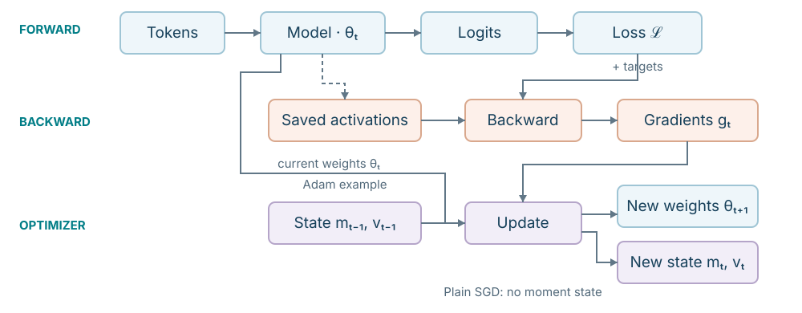
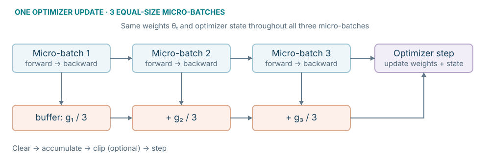

# Module 2 — Training-loop anatomy and baseline GPT

This module follows one batch from predictions to a parameter update. We first
introduce gradient descent and optimizer state, then examine the base PyTorch
loop, add three common training features, and estimate compute and memory costs.
The [companion lab](../companion/02-training-loop.md) applies these ideas to a
small GPT model.

## Optimizer 101

### Loss, gradients, and gradient descent

Let $\theta$ denote all trainable parameters. The model transforms input tokens
through intermediate **activations** into logits; cross-entropy compares those
logits with the next-token targets and produces a scalar loss $\mathcal L(\theta)$.
The loss measures the model's error on this batch. Backpropagation uses saved
activations and the chain rule to calculate the gradient
$g_t = \nabla_\theta \mathcal L_t(\theta_t)$: one derivative per parameter.
The gradient tells us how the loss changes locally as each parameter changes.

**Gradient descent** updates the parameters in the opposite direction to the
gradient:

$$\theta_{t+1} = \theta_t - \eta_t g_t.$$

The **learning rate** $\eta_t$ controls the size of that step. Too large a value
can make updates unstable; too small a value can make progress slow. The update
is based on local information and does not guarantee that the loss falls on every
batch.

**Stochastic gradient descent (SGD)** estimates the gradient from a sampled
example or mini-batch rather than the entire dataset. Plain SGD applies the rule
above using that mini-batch gradient. A different batch produces a different
estimate, so individual steps can be noisy.

### From activations to optimizer state

The forward pass creates activations and the loss; backward uses those activations
to compute parameter gradients; the optimizer reads the gradients and updates
parameters. The scalar loss is **not** passed to a standard optimizer directly,
and activations are not optimizer state. Some optimizers also keep persistent
state across updates:

| Quantity | Created or updated by | Lifetime and role |
| :--- | :--- | :--- |
| Activations | Forward pass | Intermediate values; some are saved until backward to compute derivatives. |
| Loss | Loss function | Scalar objective used to start backward. |
| Gradients | Backward pass | Per-parameter derivatives accumulated in `.grad`; cleared at the next update boundary. |
| Parameters | Initialization and optimizer step | Persistent model weights changed by the optimizer. |
| Optimizer state | Optimizer step | Persistent history used by an optimizer; plain SGD without momentum has none per parameter. |

For example, Adam keeps a first moment $m_t$ and second moment $v_t$ for each
parameter. Starting from zero, it updates them from the current gradient:

$$m_t = \beta_1m_{t-1} + (1-\beta_1)g_t,\qquad
v_t = \beta_2v_{t-1} + (1-\beta_2)g_t^2.$$

Adam corrects the moments for their initialization, then takes an adaptive step:

$$\hat m_t=\frac{m_t}{1-\beta_1^t},\quad
\hat v_t=\frac{v_t}{1-\beta_2^t},\quad
\theta_{t+1}=\theta_t-\eta_t\frac{\hat m_t}{\sqrt{\hat v_t}+\epsilon}.$$

AdamW additionally applies **decoupled weight decay**. The lab uses AdamW;
its moments are optimizer state and should be saved when a run is resumed.

---

## Base loop

The core of any PyTorch training loop has four statements, corresponding to five state transitions:

<div class="formula-highlight" style="text-align: left;" markdown>

```python
for x, y in dataloader:
    optimizer.zero_grad(set_to_none=True)  # 1. Clear gradients
    logits, loss = model(x, targets=y)     # 2. Forward pass & loss
    loss.backward()                        # 3. Backward pass
    optimizer.step()                       # 4. Update model parameters
```

</div>

To understand why this sequence works—and what breaks if any line moves—we must
examine the internal state transitions:

1. **Clearing the gradient buffer (`optimizer.zero_grad(set_to_none=True)`):**
   Every trainable `torch.nn.Parameter` has a `.grad` field. PyTorch's autograd
   engine *accumulates* gradients additively into this field (`param.grad += grad`).
   Setting `set_to_none=True` deallocates the memory buffer instead of writing
   zeros over every tensor element, saving memory bandwidth and reducing peak VRAM.
2. **The forward pass (`model(x)`):**
   As input tensors pass through each operation, PyTorch constructs a Directed
   Acyclic Graph (DAG) of `torch.autograd.Node` objects. Each node records its
   inputs, intermediate tensors needed for differentiation (saved via
   `ctx.save_for_backward`), and the vector-Jacobian product function.
3. **The loss function:**
    Computes a scalar loss from model predictions and ground-truth targets. For
    causal language models, this is categorical cross-entropy:
    $$\mathcal{L} = -\frac{1}{N}\sum_{i=1}^{N}\log p_\theta(x_i \mid x_{< i}).$$
    The returned tensor is the root of the computation graph (`loss.grad_fn` points to the last node).
4. **The backward pass (`loss.backward()`):**
   Traverses the DAG backwards from `loss` to every leaf parameter. It computes
   derivatives via the chain rule and populates `.grad` on all parameters with
   `requires_grad=True`. Crucially, **`loss.backward()` does not modify weights**.
5. **The parameter update (`optimizer.step()`):**
   Reads `.grad` from every parameter and executes the optimizer update rule in place.
   **Parameters change here and nowhere else.**

<figure markdown="span">
  { loading=lazy }
  <figcaption>One update: saved activations support backward; Adam's moments persist between updates. Inspired by the [Ultra-Scale Playbook](https://nanotron-ultrascale-playbook.static.hf.space/index.html).</figcaption>
</figure>

---

---

## Additional training features

The base loop already performs gradient descent. The following features adjust
how much data contributes to an update, limit unusually large gradients, and
change the learning rate over a run. They all operate around the same update
boundary; none changes the fundamental forward → loss → backward → step sequence.

### Gradient accumulation

<figure markdown="span">
  { loading=lazy }
  <figcaption>Three equal-size micro-batches contribute to one update. Each backward pass adds a third of its gradient; weights and optimizer state stay fixed until the step.</figcaption>
</figure>

An effective batch may not fit in memory at once. Split it into $M$ micro-batches, run forward and backward on each, and update the weights once after their gradients have accumulated:

$$\text{Tokens per update} = B_{\text{micro}} \times T \times M \times N_{\text{GPUs}}$$

Because autograd accumulates gradients additively, we must **scale the loss down by $M$**
before calling `.backward()`. Otherwise, the accumulated gradient will be $M$ times
too large:

```python
# Effective batch = grad_accum_steps * micro_batch_size
for micro in range(grad_accum_steps):
    logits, loss = model(x_micro, targets=y_micro)
    # Scale loss so the accumulated sum equals the true mean
    loss = loss / grad_accum_steps
    loss.backward()

# Update weights only once per accumulated batch
torch.nn.utils.clip_grad_norm_(model.parameters(), max_norm=1.0)
optimizer.step()
optimizer.zero_grad(set_to_none=True)
```

### Gradient norm clipping

Even with AdamW and pre-norm Transformers, self-attention layers periodically
encounter anomalous batches or pathological token sequences that cause extreme
gradient spikes. If left unclipped, a single spike can push parameters into a
divergent regime from which recovery is impossible.

We compute the global $L_2$ norm of all parameter gradients combined:

$$\|g\|_2 = \sqrt{\sum_{i=1}^P \|g_i\|_2^2}$$

If $\|g\|_2 > M_{\text{clip}}$, every gradient tensor is rescaled by
$\frac{M_{\text{clip}}}{\|g\|_2 + 10^{-6}}$:

```python
# Must occur strictly AFTER backward() and BEFORE optimizer.step()
total_norm = torch.nn.utils.clip_grad_norm_(model.parameters(), max_norm=1.0)
```

Log the pre-clip `total_norm` and how often clipping activates. Frequent clipping can signal instability; the appropriate norm depends on the model and setup.

### Learning-rate schedules: Warmup and cosine decay

The learning rate need not stay fixed. Warmup starts with smaller updates, while decay gradually reduces the learning rate later in training. Both are common choices, not universal requirements.

A standard LLM schedule incorporates two phases:

1. **Linear warmup:** Linearly increases the learning rate from $0$ to $\eta_{\text{max}}$
   over $T_{\text{warmup}}$ steps.
2. **Cosine decay:** Anneals the learning rate from $\eta_{\text{max}}$ down to
   $\eta_{\text{min}} \approx 0.1 \times \eta_{\text{max}}$ over the remaining steps:

$$\eta_t = \begin{cases}
\eta_{\text{max}} \cdot \frac{t + 1}{T_{\text{warmup}} + 1}, & t < T_{\text{warmup}} \\
\eta_{\text{min}} + \frac{1}{2} \left(1 + \cos\left(\pi \frac{t - T_{\text{warmup}}}{T_{\text{max}} - T_{\text{warmup}}}\right)\right) (\eta_{\text{max}} - \eta_{\text{min}}), & T_{\text{warmup}} \le t \le T_{\text{max}} \\
\eta_{\text{min}}, & t > T_{\text{max}}
\end{cases}$$

```python
def get_lr_cosine_schedule(step, warmup_steps, max_steps, max_lr, min_lr=0.0):
    if step < warmup_steps:
        return max_lr * (step + 1) / (warmup_steps + 1)
    if step > max_steps:
        return min_lr
    decay_ratio = (step - warmup_steps) / (max_steps - warmup_steps)
    coeff = 0.5 * (1.0 + math.cos(math.pi * decay_ratio))
    return min_lr + coeff * (max_lr - min_lr)
```

In LLM pretraining, schedules are parameterized by **global optimizer steps**, not
epochs, because datasets consist of billions of non-repeating tokens.

---

## FLOP and memory accounting

An estimate makes the cost of an update concrete. State the assumptions first:
here $N$ is the number of unique trainable scalar parameters, $B$ is the number
of sequences, $T$ the number of tokens per sequence, and $D = BT$ the number of
processed tokens. Count one multiplication and one addition as **two FLOPs**.
These are estimates, not GPU timings.

### Compute: model versus optimizer

For a dense matrix multiplication, $[D,d_\text{in}]$ times
$[d_\text{in},d_\text{out}]$ costs approximately
$2D d_\text{in}d_\text{out}$ FLOPs in the forward pass. Computing input and
weight gradients costs roughly twice the forward pass, so forward plus backward
is about $6D d_\text{in}d_\text{out}$ FLOPs for that matrix.

A common rough Transformer estimate is **$6ND$ FLOPs** for forward and backward,
when dense weight matrices dominate. It is not exact: embedding lookups,
attention's sequence-length-dependent $QK^\top$ and attention–value products,
the vocabulary head, normalization, and other operations are treated differently
or omitted. In particular, long contexts can make the attention terms substantial.
Use the actual dimensions and executed operations for a closer count.

For the optimizer, count once per parameter **per update**, not per token:

| Update | Illustrative operations per parameter | Approximate FLOPs |
| :--- | :--- | ---: |
| Plain SGD | $\eta g$ and $\theta-\eta g$ | 2 |
| Adam | two moment updates, square root, division, and parameter update | about 12 |

The Adam count assumes precomputed coefficients, counts square root and division
as one operation each, and omits bias correction and implementation details.
Actual kernels and FLOP conventions differ. Accumulation adds forward/backward
work for each micro-batch, but only one optimizer update per accumulated batch.

**Worked example.** For a 124-million-parameter GPT-2-like model and 1,000,000
processed tokens, the rough model estimate is $6 \times 124\text{M} \times
1\text{M} = 7.44\times10^{14}$ FLOPs. One plain-SGD update is about $2 \times
124\text{M} = 2.48\times10^8$ FLOPs; the illustrative Adam update is about
$1.49\times10^9$ FLOPs. The model and optimizer counts are for different units:
one million tokens versus **one** update. Multiply the optimizer cost by the
number of updates for the full run.

### Memory: what persists and what scales with the batch

Assume all listed tensors use FP32 (4 bytes per element), all parameters have
gradients, and there is no momentum for SGD:

| Storage | Plain SGD | Adam |
| :--- | ---: | ---: |
| Parameters | $4N$ bytes | $4N$ bytes |
| Gradients | $4N$ bytes | $4N$ bytes |
| First and second moments | 0 | $8N$ bytes |
| **Subtotal** | **$8N$ bytes** | **$16N$ bytes** |

For $N=124$ million, these subtotals are **0.992 GB** for SGD and **1.984 GB**
for Adam, using decimal GB. They do **not** include saved activations, temporary
buffers, inputs, allocator overhead, or other state, so they are not peak-memory
predictions. Activation memory depends on micro-batch size, sequence length,
model architecture, and implementation. Accumulation can reduce activation
memory by using smaller micro-batches, but it does not remove the persistent
parameter, gradient, or optimizer-state storage.

### From a fixed-batch test to a baseline

A fixed-batch overfit checks that targets, backward and the optimizer are
connected; it does not establish generalization. For a baseline, record the
model, data and split, optimizer and schedule, seed, hardware, code revision,
and token budget. On January 6, the lab uses instructor-prepared disjoint
JSONL documents. Its baseline script packs a fixed byte-token vocabulary itself;
the following data-pipeline lab builds on this foundation.

Compare training loss with held-out loss using a fixed validation protocol.
For nearly uniform logits, initial cross-entropy is roughly $\log V$. Record
learning rate and gradient norm to help investigate spikes, and compare runs at
the same token budget. Samples, when available, are qualitative diagnostics.
A synthetic smoke run checks mechanics but does not establish language quality.

To resume, save the model, optimizer state, step and schedule configuration,
random-number state, and data/configuration identity. Compare an interrupted and
uninterrupted run under the same planned schedule. The companion verifies exact
CPU continuation; reproducibility on a GPU needs a separate check.

### Try it

A model has $N=100$ million parameters and processes $D=500{,}000$ tokens in
100 updates. Assume FP32 and the conventions above.

1. Estimate forward/backward FLOPs for the run using $6ND$.
2. Estimate the total optimizer FLOPs for plain SGD and for Adam.
3. Calculate the parameter, gradient, and optimizer-state subtotal for each.
4. Explain what extra information is needed to estimate peak memory.

??? example "Check your estimates"
    1. $3\times10^{14}$ model FLOPs.
    2. SGD: $2\times10^{10}$ FLOPs; Adam: approximately $1.2\times10^{11}$ FLOPs.
    3. SGD: 0.8 GB; Adam: 1.6 GB, both in decimal GB.
    4. At least the activation and temporary-buffer sizes, which depend on the
       micro-batch, context length, architecture, and implementation.

---

[:material-file-pdf-box: View Lecture Slides (PDF)](../slides/02-training-loop.pdf){ .md-button target="_blank" }
[:material-code-tags: Practical Companion Guide](../companion/02-training-loop.md){ .md-button .md-button--primary }
