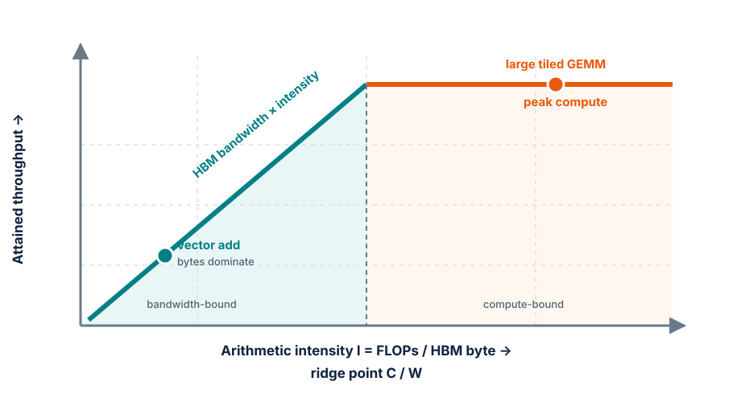

# Module 4 — Single-GPU performance

## Purpose

Build a hardware model of one GPU, then use it to predict and explain the
performance of the course training step. Optimization begins with a bottleneck
hypothesis, not a bag of flags.

The main reference is the Scaling Book chapter
[How to Think About GPUs](https://jax-ml.github.io/scaling-book/gpus/). Its
hardware numbers are examples, not universal constants: always pair a formula
with the specification of the GPU actually used.

## Learning goals

By the end of the module, students should be able to:

- distinguish CUDA cores, Tensor Cores, SMs and GPU memory levels;
- explain warps, occupancy, divergence and memory coalescing at a useful level;
- calculate arithmetic intensity and place an operation on a roofline;
- decompose training memory into persistent state, activations and temporary
  workspaces;
- read a profiler trace as a timeline of CPU launch, GPU kernels and transfers;
- choose an optimization that targets the measured bottleneck;
- report throughput, memory and numerical behavior without changing the task.

## A GPU is not one fast processor

A modern NVIDIA training GPU contains many **streaming multiprocessors** (SMs).
Each SM combines:

- **Tensor Cores** specialized for dense low-precision matrix multiplication;
- **CUDA cores** for flexible scalar/vector arithmetic and reductions;
- warp schedulers that issue instructions to groups of 32 threads;
- registers and shared memory/L1 close to the compute units.

The full device also has a shared L2 cache and high-bandwidth memory (HBM).
Calling all of these pieces “GPU compute” hides the questions that matter:

- Is the kernel feeding Tensor Cores with supported shapes and precision?
- Are enough independent warps resident to hide memory latency?
- Are threads reading adjacent memory locations?
- Does the working set remain on chip or repeatedly travel to HBM?
- Are many tiny kernels dominated by launch overhead?

## From thread to warp to SM

CUDA exposes a hierarchy:

```text
grid
  └── thread blocks
        └── warps of 32 threads
              └── individual threads
```

Threads in a warp follow a SIMT model: they normally execute the same
instruction on different data. If a branch sends some threads down one path and
the rest down another, the warp executes both paths with inactive lanes masked.
This **warp divergence** lowers useful work per issued instruction.

An SM keeps several warps resident and switches among ready warps when another
is waiting for data. More resident warps can hide latency, but occupancy is
limited by registers, shared memory and the maximum blocks/warps supported by
the SM. Maximum occupancy is not a goal by itself: a kernel using more registers
may do less memory traffic and run faster despite lower occupancy.

### Why shapes matter

Tensor Cores operate on tiles. Matrix dimensions, dtype, alignment and layout
determine whether an implementation can use efficient kernels. Padding a
vocabulary or hidden dimension to a friendly multiple can make a mathematically
larger operation faster.

This is why nanoGPT uses a padded vocabulary size for from-scratch training and
why benchmark results must report shapes, not just parameter counts.

## The memory hierarchy

Memory becomes larger and slower as it moves away from the execution units:

| Level | Scope | Typical role | Optimization question |
| --- | --- | --- | --- |
| Registers | one thread | scalars, accumulators | are spills occurring? |
| Shared memory / L1 | one SM/block | reused tiles | is reuse worth the limited capacity? |
| L2 | whole GPU | shared cache | is the access pattern cache-friendly? |
| HBM | whole GPU | weights, states, activations | are bytes dominating runtime? |
| Host memory | CPU | dataset, offloaded state | are transfers on the critical path? |

For an H100 example in the Scaling Book, HBM bandwidth is about 3.35 TB/s while
peak BF16 Tensor Core throughput is about 990 TFLOP/s. The ratio is the key:
the device can perform hundreds of floating-point operations in the time needed
to stream one byte from HBM.

This imbalance explains why recomputing a value can be faster than storing and
reloading it, and why kernel fusion can help even when it does not reduce FLOPs.

## Roofline reasoning

For an operation:

\[
I = \frac{\text{FLOPs}}{\text{bytes transferred}}
\]

is its arithmetic intensity. Let \(C\) be peak compute throughput and \(W\)
memory bandwidth. The roofline bound is

\[
P_{\max} = \min(C, I W),
\]

or equivalently

\[
t \ge \max\left(
\frac{\text{FLOPs}}{C},
\frac{\text{bytes}}{W}
\right).
\]

The **ridge point** is \(C/W\). Below it, the operation is bandwidth-bound;
above it, it can be compute-bound.

<figure markdown="span">
  { loading=lazy }
  <figcaption>The roofline is a prediction: place an operation by arithmetic intensity, then look for the lower ceiling.</figcaption>
</figure>

### Worked example 1 — vector addition

Adding two FP32 vectors and writing the result performs one FLOP while moving
approximately 12 bytes per element: two 4-byte reads and one 4-byte write.

\[
I_{\text{add}} \approx \frac{1}{12}\ \text{FLOP/byte}.
\]

No amount of Tensor Core peak throughput changes this low intensity. Improve
the memory path or fuse the addition into a neighboring operation so the
intermediate is never written to HBM.

### Worked example 2 — matrix multiplication

For \(A\in\mathbb{R}^{M\times K}\) and
\(B\in\mathbb{R}^{K\times N}\), the product performs approximately
\(2MKN\) FLOPs. A simple BF16 byte estimate is

\[
2(MK + KN + MN)\ \text{bytes}.
\]

Larger matrices reuse each loaded element many times, raising arithmetic
intensity. Small batch or token dimensions can leave the same linear layer
bandwidth- or latency-bound even though its large-batch form is compute-bound.

## Training memory: what occupies VRAM?

Training memory has two main components: **model state**, which scales with
parameter count, and **activations**, which grow with batch and sequence length.
Temporary workspaces add to the peak.

### 1. Model state: parameters, gradients, and optimizer states

For mixed-precision AdamW, use this standard budget for $N$ parameters:

| State | Dtype | Bytes/parameter |
| --- | --- | ---: |
| Forward weights | BF16 / FP16 | 2 |
| Gradients | BF16 / FP16 | 2 |
| Master weights | FP32 | 4 |
| Adam first moment | FP32 | 4 |
| Adam second moment | FP32 | 4 |
| **Total** | | **16** |

Thus model state takes approximately **$16N$ bytes**. FP32 gradients raise
this to $18N$ bytes. The exact layout depends on the training implementation,
but $16N$ is a useful planning estimate.

### 2. Dynamic memory: activation accounting per layer

Let $B$ be the **resident micro-batch**, $T$ the sequence length, $d$ the hidden
width, $h$ the number of attention heads, and $L$ the layer count. Consider
ordinary multi-head attention and a two-linear-layer GELU MLP of width $4d$.

Assume standard unfused attention with dropout, 16-bit activations and
one-byte dropout masks. We count the main tensors saved for backward
([Korthikanti et al., Section 4.1](https://arxiv.org/abs/2205.05198)):

| Saved tensors | Bytes per layer |
| --- | ---: |
| Two normalization inputs | $4BTd$ |
| Shared input to Q/K/V projections, counted once | $2BTd$ |
| Q, K, V for attention backward | $6BTd$ |
| Softmax probabilities and attention-dropout output | $4BhT^2$ |
| Attention-dropout mask | $BhT^2$ |
| Output-projection input and residual-dropout mask | $3BTd$ |
| MLP up-projection input | $2BTd$ |
| GELU input and down-projection input | $16BTd$ |
| MLP residual-dropout mask | $BTd$ |
| **Total** | **$34BTd + 5BhT^2$** |

Softmax backward needs the probabilities, not the pre-softmax logits.
Across $L$ layers, the estimate is

\[
M_{\text{activations}} \approx LBT(34d+5hT)\text{ bytes}.
\]

The key distinction is **linear growth with $B$** and a **quadratic attention
term in $T$**. The vocabulary head and temporary workspaces add to this budget.

#### The impact of memory optimizations

- **FlashAttention:** avoids saving the full attention matrix, removing the
  quadratic storage term. Attention activation memory becomes $O(BTd)$ per
  layer, while attention compute remains quadratic in $T$. PyTorch SDPA can
  select this efficient backend on supported hardware.
- **Activation checkpointing:** saves block inputs and recomputes intermediate
  activations during backward. Checkpointing every block reduces saved inputs
  to roughly $2LBTd$ bytes, plus the current block's working memory. One extra
  forward pass changes block compute from about $3F$ to $4F$: roughly **33%
  more FLOPs**.
- **Gradient accumulation:** uses smaller micro-batches to reach the same
  effective batch size. Activation memory follows the resident micro-batch.

Measure both **allocated** memory (live tensors) and **reserved** memory
(allocator-managed storage) after warm-up. The measured peak includes temporary
workspaces as well as the tensors in these estimates.

---

## First-principles FLOPs accounting: Attention vs. MLP

To compute hardware utilization (MFU) and arithmetic intensity, we must count the theoretical floating-point operations required by the model.

In digital arithmetic, a matrix multiply-accumulate (MAC) operation involves **1 multiplication and 1 addition**, which counts as **$2\text{ FLOPs}$**. Therefore, multiplying a matrix of shape $(M \times K)$ by a matrix of shape $(K \times N)$ requires:

\[
\text{FLOPs}_{\text{GEMM}} = 2 M K N.
\]

### 1. Forward pass FLOPs per token

Count the dense matrix products for a training sequence and divide by its
$BT$ tokens. Assume ordinary multi-head attention with $d_h=d/h$, a $4d$ GELU
MLP, and count full $T\times T$ attention products. We focus on matrix
multiplications, which dominate the FLOPs:

| Component | Matrix products | Forward FLOPs/token |
| --- | --- | ---: |
| Q/K/V projections | Three $d\times d$ projections | $6d^2$ |
| Attention output projection | One $d\times d$ projection | $2d^2$ |
| Attention scores | $QK^\top$ across all heads | $2Td$ |
| Attention over values | $SV$ across all heads | $2Td$ |
| GELU MLP, width $4d$ | $d\to4d\to d$ | $16d^2$ |
| SwiGLU MLP, width $8d/3$ | Two up projections, one down projection | $16d^2$ |

For example, the batched Q/K/V projections cost $3(2BTd^2)$ FLOPs.
The score product has shapes $(T\times d_h)(d_h\times T)$ per head;
over $B$ sequences and $h$ heads it costs $2BhT^2d_h=2BT^2d$ FLOPs.
Divide each by $BT$ to obtain its table entry.

The SwiGLU row is an **alternative** to the GELU row, with
$d_{\mathrm{ff}}=8d/3$ before rounding: $6d\,d_{\mathrm{ff}}=16d^2$ FLOPs.
The main result is:

- **Attention linear projections:** $6d^2 + 2d^2 = 8d^2$ FLOPs/token.
- **MLP linear projections:** $8d^2 + 8d^2 = 16d^2$ FLOPs/token.
- **The $1/3$ to $2/3$ rule:** In this block, the feed-forward MLP performs **twice as many FLOPs** as the attention projections ($16d^2$ vs $8d^2$), and holds twice as many parameters ($8d^2$ vs $4d^2$).
- **The quadratic term:** The two attention products contribute $4Td$
  FLOPs/token, or $4T^2d$ per sequence. Their ratio to the projection cost is
  $T/(6d)$; they exceed all block projections when $T>6d$ under this convention.

### 2. The $2\times$ backward multiplier

For every linear layer $Y = X W$ in the forward pass, the backward pass must compute two distinct matrix derivatives via the chain rule:

**Gradient with respect to input activations:**

\[
\frac{\partial \mathcal{L}}{\partial X}
= \frac{\partial \mathcal{L}}{\partial Y} W^\top
\quad \implies 2MKN\text{ FLOPs}.
\]

**Gradient with respect to layer weights:**

\[
\frac{\partial \mathcal{L}}{\partial W}
= X^\top \frac{\partial \mathcal{L}}{\partial Y}
\quad \implies 2MKN\text{ FLOPs}.
\]

Backward therefore costs roughly twice as much as forward:

\[
\text{Backward FLOPs} \approx 2 \times \text{Forward FLOPs},
\]

Adding forward and backward gives:

\[
\text{Total Training FLOPs} = \text{Forward} + \text{Backward} \approx 3 \times \text{Forward FLOPs}.
\]

Embedding lookup is a gather, not a dense matrix multiply; token IDs do not
receive gradients. A dense vocabulary head still incurs its full matrix cost
when its weights are tied to the embedding table.

### 3. Total training FLOPs per token

Multiplying the forward matrix operations by 3 yields:

- **Transformer blocks (per layer):** $3 \times (8d^2 + 16d^2) = 72 d^2$ FLOPs/token.
- **Attention matrix products (per layer):** $3 \times (4 T d) = 12 T d$ FLOPs/token.
- **Output vocabulary head:** $3 \times (2 d V) = 6 d V$ FLOPs/token.

Summing across all $L$ layers:

\[
\text{Training FLOPs per token} \approx 72 L d^2 + 12 L d T + 6 d V.
\]

Ignoring biases and normalization parameters, the block matrix parameter count is $N_{\text{blocks}} = 12Ld^2$. The block projection term simplifies to:

\[
72 L d^2 = 6 N_{\text{blocks}}.
\]

Define $N_{\text{matrix}}=12Ld^2+dV$: the block matrix weights plus the
vocabulary-head matrix, counted once even when tied. Then

\[
\text{FLOPs/token} \approx 6N_{\text{matrix}} + 12LdT.
\]

This matches the companion's
[`compute_flops_per_token`](https://github.com/brain-bzh/llm-course-companion/blob/main/nanolm/profile_utils.py).
Ignoring the smaller bias, normalization and positional-embedding terms,
$N_{\text{matrix}}$ approximates the parameter count of a model with tied
embeddings.

For $D$ training tokens, the familiar rule of thumb is **$6ND$ FLOPs**, with
$12LdTD$ added for the attention matrix products. For example, $L=12$, $d=768$,
$V=50{,}304$, $T=1024$ gives about **855 million FLOPs/token**, including
**113 million (13%)** for attention products.

---

## FLOPs, tokens/s, MFU and time-to-train

Useful metrics answer different questions:

| Metric | What it answers |
| :--- | :--- |
| **tokens/s** | How fast does this exact workload progress? |
| **step time** | Where did latency change? |
| **peak memory** | What larger workload or micro-batch might fit? |
| **achieved FLOP/s** | How much arithmetic ran per second? |
| **MFU (Model FLOPs Utilization)** | What fraction of theoretical peak performed model-required FLOPs? |
| **HFU (Hardware FLOPs Utilization)** | What fraction includes executed arithmetic such as recomputation? |
| **time-to-target** | Did the end-to-end experiment improve? |

Compute MFU as model FLOPs/token times tokens/s divided by the GPU's peak
FLOP/s at the training precision. MFU excludes checkpoint recomputation;
HFU includes that extra arithmetic.

An optimization can raise hardware utilization while slowing time-to-target, for example by adding unnecessary recomputation. Tokens/s and validation behavior remain the primary outcomes for this course.

## Read a profiler trace as a causal story

Profile after warmup, over multiple representative steps, with the same batch
and synchronization points used in the benchmark.

Look for:

1. **CPU gaps:** the GPU waits because data loading or Python launch is late;
2. **many tiny kernels:** launch overhead or unfused pointwise work dominates;
3. **large GEMMs with low utilization:** shapes or precision miss an efficient
   kernel path;
4. **explicit device copies:** input transfer or accidental host round trips;
5. **attention matrix kernels:** a non-fused attention path may materialize
   \(T\times T\) scores;
6. **allocator churn:** repeated allocation or shape changes prevent reuse;
7. **synchronization:** logging `.item()`, timing without CUDA events, or memory
   queries can serialize asynchronous work.

Use top-down questions:

- Is the GPU busy?
- If busy, is it doing useful kernels?
- If useful, are those kernels compute-, bandwidth- or latency-bound?
- Which source operation launched the dominant kernel?

## Optimization ladder

Change one mechanism at a time and re-measure correctness, throughput and
memory.

### 1. Input pipeline

- prefetch and use pinned host memory when transfers warrant it;
- avoid tokenization or decompression on the critical path;
- check that batches are ready before the GPU asks for them.

### 2. Precision

A tensor stored in BF16 takes half the bytes of FP32 and retains FP32-like
exponent range. BF16 matrix products can use fast Tensor Core paths, but
autocast does not halve every tensor or convert persistent FP32 parameters.
FP16 may need loss scaling. Precision changes require a loss/gradient
comparison, not only a speed measurement.

### 3. Scaled-dot-product attention

Efficient SDPA/FlashAttention tiles Q, K and V through on-chip memory and avoids
writing the full attention matrix to HBM. It is exact attention with a different
IO schedule, not sparse or approximate attention.

### 4. Fused operations

Fusion combines operations so intermediates stay in registers or shared memory.
Typical opportunities include bias plus activation, normalization, optimizer
updates and the cross-entropy path.

### 5. Compilation

Compilation can fuse graphs, specialize shapes and reduce Python/kernel-launch
overhead. Separate compile time from steady-state time, and watch for graph
breaks or recompilation caused by changing shapes.

### 6. Activation checkpointing

Checkpointing saves memory by discarding selected activations and recomputing
them during backward. It is valuable only if the released memory enables a
better micro-batch or prevents an OOM at acceptable time cost.

## Benchmark protocol

For every variant:

1. use the same model, batch tensors, precision target and optimizer semantics;
2. warm up until compilation and caches stabilize;
3. time enough steps to report a distribution, not one value;
4. synchronize correctly around timing boundaries;
5. record median step time, tokens/s and peak allocated/reserved memory;
6. compare loss and gradients on a fixed batch within declared tolerances;
7. save the profiler trace supporting the bottleneck explanation.

Report environment details: GPU model, driver/runtime, framework version,
power mode and whether other processes shared the device.

## In-class investigation

### Part A — roofline worksheet

For vector addition, LayerNorm and one course-model matrix multiplication:

1. estimate FLOPs and HBM bytes;
2. compute arithmetic intensity;
3. find the target GPU's \(C/W\) ridge point;
4. predict the bound;
5. name one optimization consistent with that prediction.

### Part B — memory prediction

Before running, estimate persistent model-state memory and activation growth as
micro-batch and sequence length change. Then compare with measured allocated
and reserved peaks. Explain the largest discrepancy.

### Part C — one-change ablation

Start with eager FP32 or the declared baseline. Add one of BF16, SDPA,
compilation or checkpointing. Produce a table with:

| Variant | tokens/s | median step ms | peak allocated | peak reserved | loss delta |
| --- | ---: | ---: | ---: | ---: | ---: |

The conclusion must name the bottleneck the change targeted and whether the
trace supports the explanation.

## Exit ticket

1. Why can a GPU with enormous peak TFLOP/s still be slow on vector addition?
2. What is the difference between bandwidth-bound and latency-bound?
3. Why can lower occupancy still produce a faster kernel?
4. How can fusion improve runtime without reducing mathematical FLOPs?
5. Why is peak reserved memory different from live tensor memory?

## Expected output

A measurement-first performance report containing a hardware-aware prediction,
a memory budget, baseline trace, one-change ablations and a justified final
single-GPU configuration.

## References

- [How to Think About GPUs](https://jax-ml.github.io/scaling-book/gpus/)
  — primary conceptual spine for GPU execution, memory and rooflines;
- [PyTorch profiler recipe](https://docs.pytorch.org/tutorials/recipes/recipes/profiler_recipe.html)
  — trace collection and interpretation;
- [PyTorch performance tuning guide](https://docs.pytorch.org/tutorials/recipes/recipes/tuning_guide.html)
  — practical tuning mechanisms;
- [FlashAttention](https://arxiv.org/abs/2205.14135)
  — IO-aware exact attention and tiling analysis.

---

[:material-file-pdf-box: View Lecture Slides (PDF)](../slides/04-single-gpu.pdf){ .md-button target="_blank" }
[:material-code-tags: Practical Companion Guide](../companion/04-single-gpu.md){ .md-button .md-button--primary }

